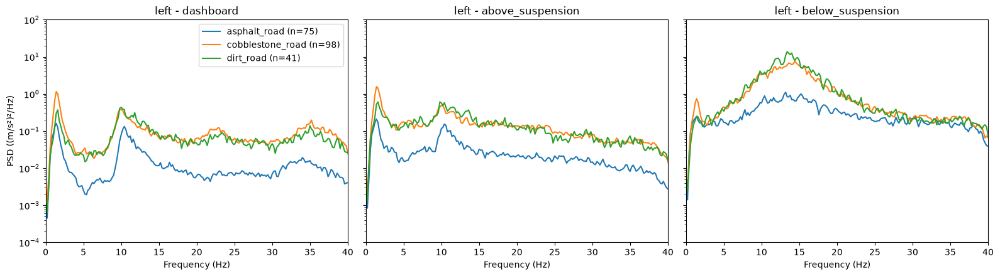
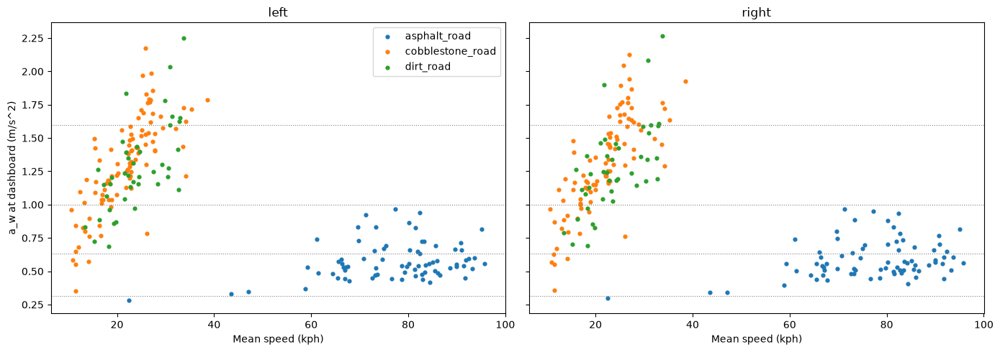

# PVS Ride & Suspension Analysis
 
Ride and suspension analysis of a passenger car from real on-road accelerometer data: vibration modes, suspension transmissibility and ISO 2631-1 ride comfort, using Python (pandas, NumPy, SciPy, Matplotlib) and SQLite.
 
> **Status:** complete analysis of trip PVS 1 (one vehicle, both front corners). Extension to all nine trips (three vehicles, drivers and scenarios) in progress.



## Key results (PVS 1)
 
- **Vibration modes:** body (sprung-mass) mode at 1.3–1.55 Hz; wheel hop (unsprung-mass) at 13–16 Hz, independent of speed.
- **Suspension transmissibility:** fitting a base-excited single-degree-of-freedom model to the measured transmissibility gives a damping ratio of 0.40–0.57. Where coherence is high (9–15 Hz), the suspension transmits 15–30 % of the wheel vibration to the body.
- **Transmission path:** the ~10 Hz peak measured on the body is wheel-hop vibration transmitted through the suspension. A local transmissibility maximum at 10–12 Hz is not reproduced by the single-degree-of-freedom model, pointing to additional compliance in the path (bushings, strut top mount or a local body mode).
- **Ride comfort (ISO 2631-1, Wk, dashboard):** mean weighted acceleration of 0.58 m/s² on asphalt, 1.31 m/s² on cobblestone and 1.28 m/s² on dirt. Cobblestone has more unweighted vibration than dirt, but most of the difference lies at frequencies of low human sensitivity, so both are rated almost equally after weighting.
- **Event analysis:** the highest crest factor on asphalt corresponds to a cobblestone-to-asphalt transition crossed at an angle: the left wheel hits the edge ~0.15 s before the right wheel, exciting body roll.



## Data
 
[PVS – Passive Vehicular Sensors Datasets](https://www.kaggle.com/datasets/jefmenegazzo/pvs-passive-vehicular-sensors-datasets) (J. Menegazzo and A. von Wangenheim). Each trip includes:
 
- MPU-9250 inertial sensors sampled at 100 Hz on both front corners: dashboard, above the suspension (body, top of the strut tower – sprung mass) and below the suspension (lower control arm – unsprung mass).
- GPS at 1 Hz (position and speed).
- Surface labels (asphalt, cobblestone, dirt).

Raw data is not included in this repository. Download the following files for each trip into `data/raw/PVS<n>/`:
 
```
dataset_gps_mpu_left.csv
dataset_gps_mpu_right.csv
dataset_labels.csv
```
 
## Method

| Part | Notebook | Content |
| --- | --- | --- |
| 1 | `01_exploration.ipynb` | Data structure, sampling rate, physical checks |
| 2 | `02_preprocessing.ipynb` | Frozen-sample and saturation detection, zero-phase band-pass filter (0.5–40 Hz), 5 s windows that never cross a surface change |
| 3 | `03_spectral.ipynb` | Welch PSD averaged over windows, by surface, position and speed; band RMS and modal frequencies |
| 4 | `04_transmissibility.ipynb` | H1 transmissibility, phase and coherence between wheel and body; half-power damping estimate |
| 5 | `05_comfort.ipynb` | ISO 2631-1 Wk weighting, weighted RMS (frequency and time domain), crest factor and VDV |
| 6 | `06_database.ipynb` | SQLite database (trips, windows, metrics) and SQL queries *(queries in progress)* |
| 7 | `07_quarter_car.ipynb` | Coherence-weighted least-squares fit of a base-excited single-degree-of-freedom model |
 
Reusable functions are in `src/` (`data_io.py`, `preprocessing.py`, `spectral.py`, `comfort.py`, `db.py`, `quarter_car.py`).

## Limitations
 
- Comfort is evaluated at the dashboard, not at the seat, and only in the vertical axis: a_w is an indicator of cabin vibration rather than an ISO-compliant assessment.
- Speed and surface are confounded in PVS 1 (cobblestone and dirt only at 10–40 km/h, asphalt mostly above 60 km/h).
- Only the natural frequency and damping ratio of the body mode can be identified; spring rate and damping coefficient require the sprung mass. The wheel-hop mode cannot be identified without a road-profile measurement.
- Transmissibility estimates are only interpreted where coherence is high (above ~0.5).
## Future work
 
- Extend the analysis to all nine trips and compare the three vehicles.
- Use the sprung mass (vehicle specifications or corner weights) to obtain effective wheel rate and damping.
- Extend the transmission-path model with a series compliance to explain the 10–12 Hz transmissibility maximum.
- Two-degree-of-freedom quarter-car model with road-profile input to study the trade-off between ride comfort and tyre contact force.

## How to run
 
```
python -m venv .venv
.venv\Scripts\activate          # Windows
pip install -r requirements.txt
```
 
Download the data (see above) and run the notebooks in order (`01` to `07`). Processed files are written to `data/processed/`.
 
## Repository structure
 
```
├── data/
│   ├── raw/            # PVS CSV files (not included)
│   └── processed/      # windows, filtered signals and ride.db (generated)
├── figures/            # figures used in this README
├── notebooks/          # one notebook per analysis part
├── sql/                # SQL queries
├── src/                # reusable functions
├── requirements.txt
└── README.md
```